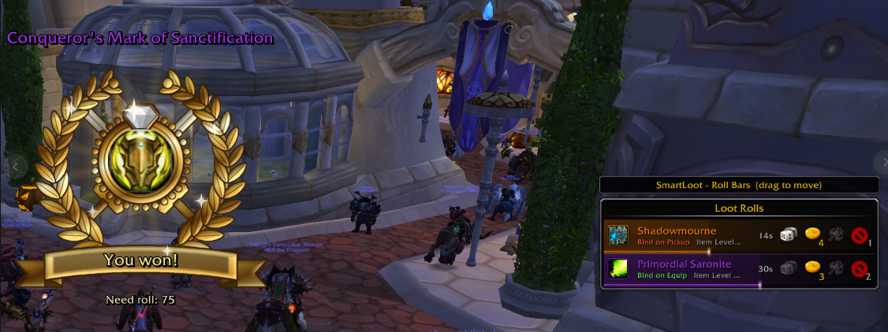
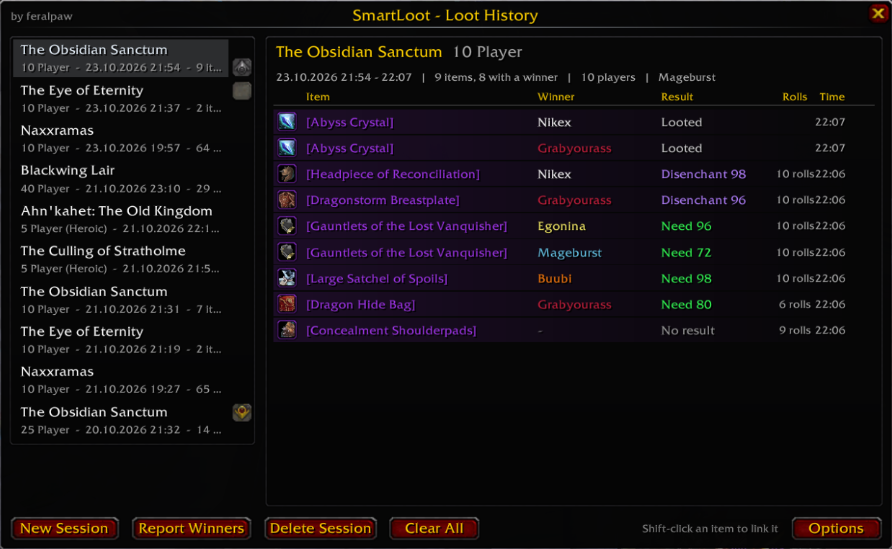

# SmartLoot

> World of Warcraft **3.3.5a (WotLK)** addon · made by **feralpaw**

Replaces the Blizzard loot window and the need/greed roll frames with a cleaner, movable design – plus a loot history for every raid and dungeon.

## Screenshots

## Features
- Movable loot window, works fully without ElvUI
- Restyled roll bars (Need / Greed / Disenchant / Pass)
- Colour themes
- Loot history per instance: every roll and every winner
- Test mode to preview the frames
- annoucement "You won" with nice visual and sound
- Options under *Esc → Interface → AddOns → SmartLoot*

## Commands
| Command | What it does |
|---|---|
| `/loot` | Open the loot history |
| `/smartloot` or `/sloot` | Open options |
| `/smartloot test` | Toggle test mode (move the frames) |
| `/smartloot lock` | Lock / unlock frames |
| `/smartloot reset` | Reset frame positions |

## Installation
1. Download the latest ZIP from **Releases** (or *Code → Download ZIP*).
2. Copy `SmartLoot` into `World of Warcraft/Interface/AddOns/`.
   The folder name must stay exactly like this (no `-main` suffix).
3. Restart the game or type `/reload`.

## License
MIT – see [LICENSE](LICENSE).
